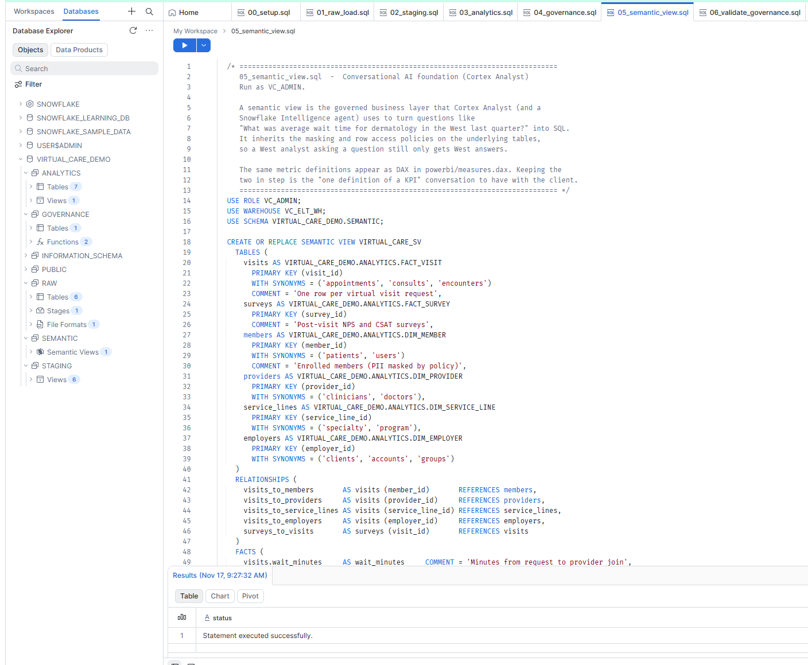
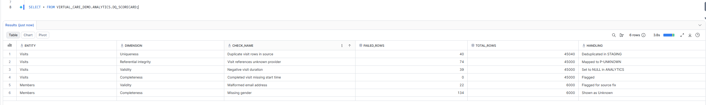
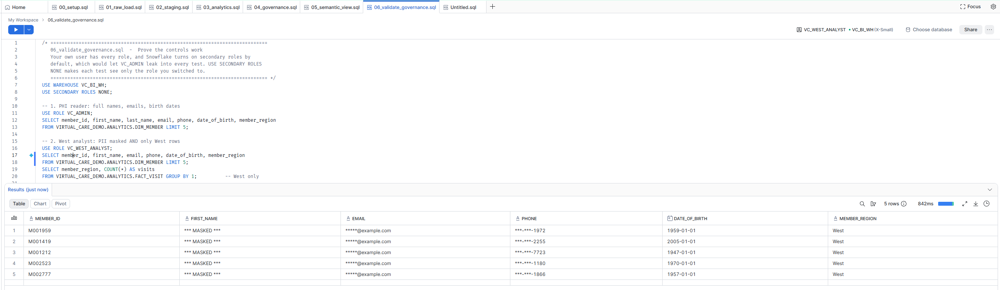
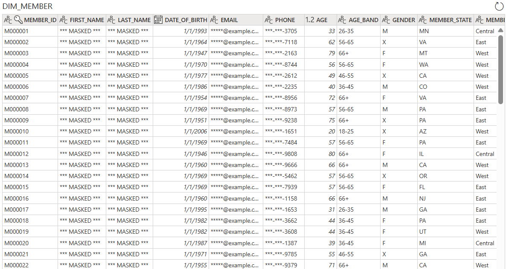
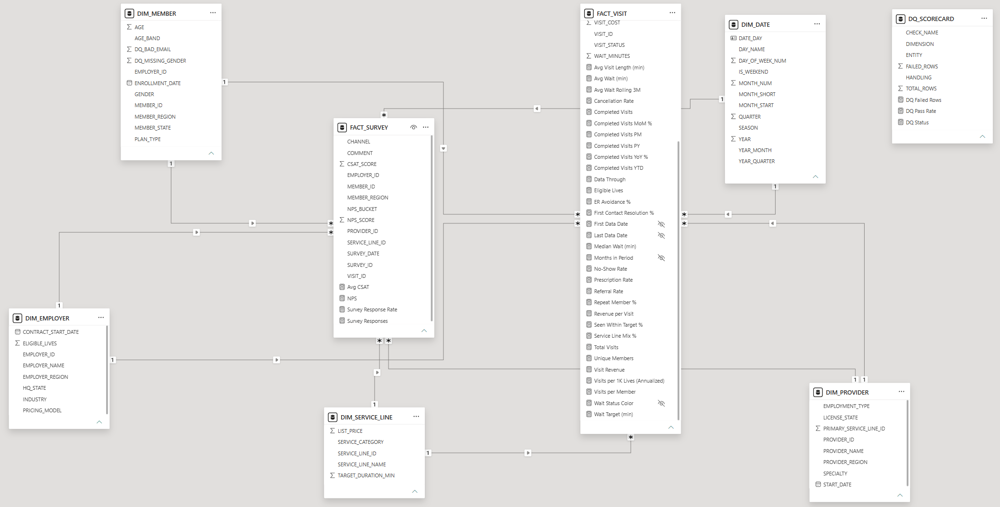
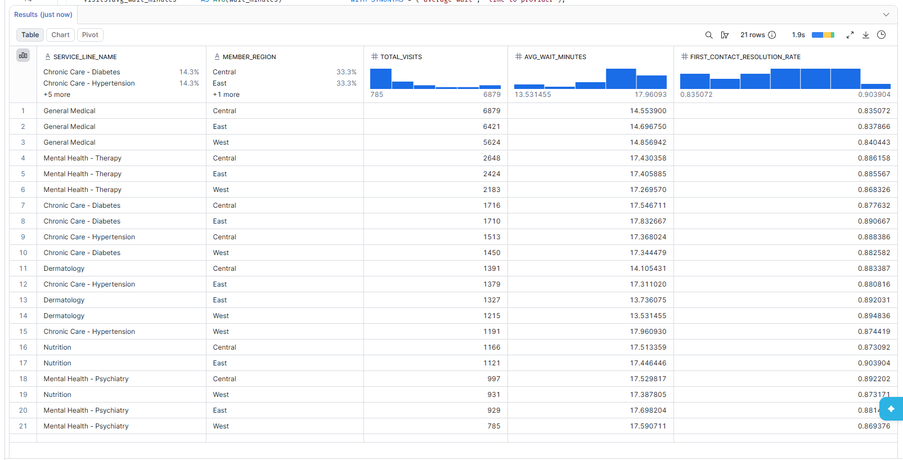

Most dashboards are only as trustworthy as the pipeline behind them. For this project I built the whole pipeline myself, from raw files to an executive dashboard, so every number on the page can be traced back to where it came from.

The company is fictional and all of the data is synthetic: *Cascade Virtual Care*, a telehealth provider with 6,000 members, 24 employer customers, 106 providers and 22 months of visits across seven service lines. I generated it with a seeded Python script and planted the kinds of problems real source data has, so the pipeline had something to catch.

**Links:** [code on GitHub](https://github.com/brandyemurray/virtual-care-analytics), [walkthrough notebook](https://github.com/brandyemurray/virtual-care-analytics/blob/main/notebooks/virtual_care_walkthrough.ipynb), [slide walkthrough (PDF)](/doc/virtual-care-walkthrough.pdf).

## The questions it answers

An operations leader at a virtual care company needs to know four things at a glance: is volume growing, are members seen quickly, is the care effective, and are employer customers getting value. The dashboard answers those, but the harder question sits underneath: *can I trust these numbers?* That's what most of the work was for.

## The architecture

Data moves through four layers in Snowflake, each with one job:

| Layer | What happens there |
|---|---|
| **RAW** | The six CSV extracts land exactly as received, all as text, with the source file recorded on every row. A bad value can never fail the load. |
| **STAGING** | Views type the data, remove duplicates and flag every problem they find. Nothing is silently dropped. |
| **ANALYTICS** | A star schema with two fact tables (visits and surveys) and five dimensions, built for Power BI. |
| **SEMANTIC** | A semantic view that defines each metric once, so Cortex Analyst can answer plain-English questions. |

Governance sits alongside all of it: tags, masking policies, row access policies and data quality checks are applied in Snowflake, so they travel with the data into every tool that reads it. Separate warehouses for loading and reporting, plus a resource monitor, keep cost visible and capped.

Every layer is a numbered, commented SQL script, with a teardown script to rebuild from scratch.

## Catching the planted problems

The generator planted five kinds of defect. The staging layer handles each one, and a scorecard view counts them so the totals always reconcile:

| Problem | Rows | How it's handled |
|---|---|---|
| Duplicate visit rows | 40 | Removed in staging |
| Visits pointing to a provider that doesn't exist | 74 | Mapped to an "Unknown provider" row so totals stay whole |
| Negative visit durations | 39 | Set to NULL in the star schema |
| Malformed email addresses | 22 | Flagged for a source fix |
| Missing gender | 134 | Reported as "Unknown" |

The checks run inside Snowflake as Data Metric Functions, and the scorecard view gives the report a simple, stable feed.

## Governance that travels with the data

Two controls do most of the work:

- **Tag-based masking.** Each personal-data column carries a `PII_TYPE` tag, and the masking policy is attached to the tag rather than the column. Tag a new column and it's protected automatically. Names are hidden, emails keep only the domain, phones show the last four digits and birth dates are generalized to the year.
- **Row access from an entitlements table.** A policy checks which regions the current role is entitled to. Adding a regional analyst is an `INSERT`, not a code change, and a role with no entitlement sees nothing at all.

Signed in as a West-region analyst, the same query returns masked fields and only West rows: 13,379 of the 45,000 visits.

Power BI connects through a least-privilege service account that signs in with a key pair, since Snowflake is retiring password-only sign-in. The masking holds all the way into the report, and the personal-data columns are never imported into the model at all. The strongest control is not moving the data.

## The Power BI model

The semantic model is a clean star schema: ten relationships, all single-direction and many-to-one, a marked date table with proper sort orders, and DAX measures grouped by purpose: volume, access, quality, experience and finance, with year-over-year and rolling three-month comparisons. The project is saved as a Power BI project (`.pbip`), so the model lives in Git as readable text.

## What the data says

The [walkthrough notebook](https://github.com/brandyemurray/virtual-care-analytics/blob/main/notebooks/virtual_care_walkthrough.ipynb) recomputes every KPI on the dashboard from the raw CSVs in pandas, and they all match: 39,739 completed visits, a 16.0-minute average wait, 86.4% first-contact resolution, an NPS of 15 and $4.1M in visit revenue. It also pulls out the story:

- **Volume is up 44% year over year** for January through October.
- **Behavioral health is 22% of visits but 34% of revenue**, because therapy and psychiatry visits are longer and priced higher.
- **Waits sit just over the 15-minute target**, and the scheduled programs drive the gap. General medical and dermatology are under target.
- **Wait time is the satisfaction lever.** Members seen within 15 minutes give an NPS of +37; members who wait more than 30 minutes give −67. The generator models that relationship, and the notebook shows how strongly it plays out.

## Ready for plain-English questions

The semantic view defines each metric once, with business synonyms, so Cortex Analyst can turn a question like *"What's the average wait by service line in each region?"* into governed SQL. Because it reads the same tables, AI answers inherit the same masking and row access as the dashboard.

## What I'd do next in production

- Move the transformations to dbt models or Snowflake Dynamic Tables, with tests that assert the same reconciliation the notebook does.
- Deploy Snowflake objects and the Power BI project from Git through a CI/CD pipeline.
- Use Microsoft Entra ID single sign-on with DirectQuery, so row access applies to each viewer personally.
- Route data quality results to the owning team when a threshold is crossed.
- Add a machine learning layer on the same platform, starting with predicting appointment no-shows.

*Built with AI-assisted development (Claude Code), which I directed and checked at every step.*
