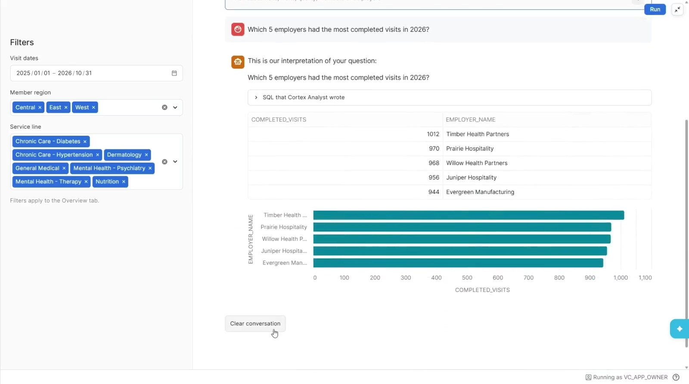
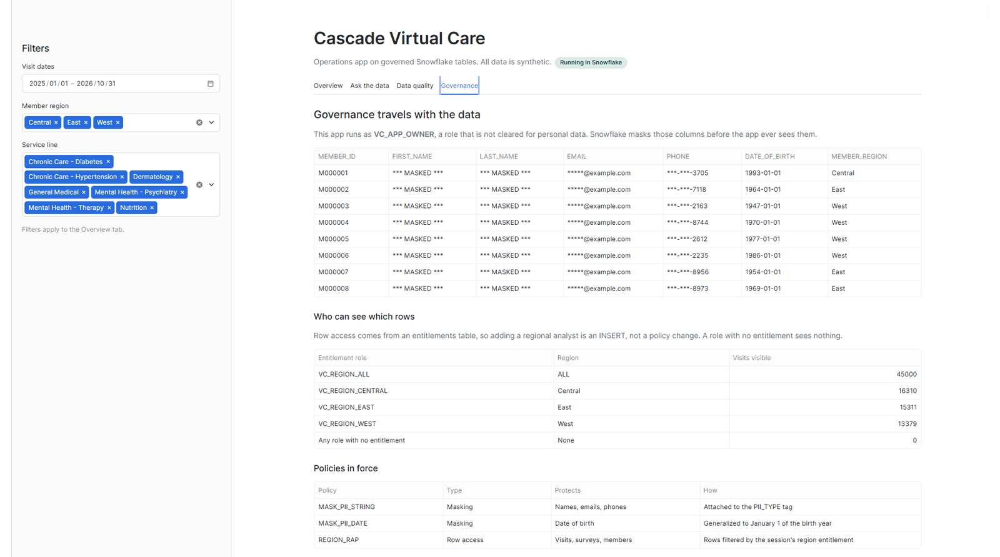
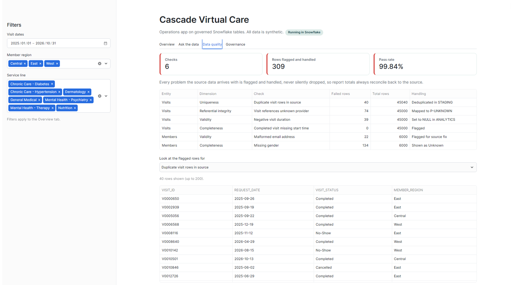
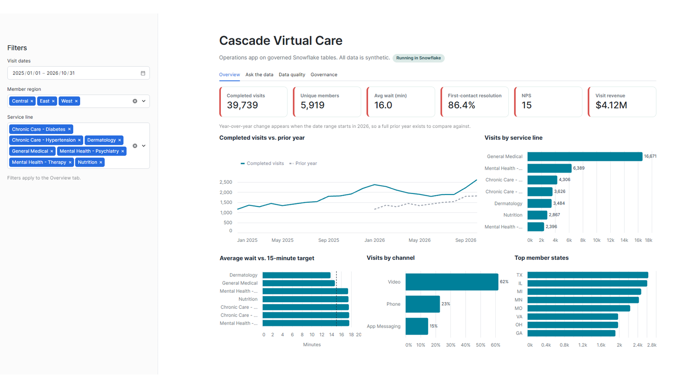

I built the [Virtual Care Analytics platform](/2026/11/19/virtual-care-analytics.html) once in Snowflake, with layered schemas, masking, row-level security and data quality checks, and then put two front ends on it. Power BI is one. This is the other, and it's the one I'd pick: a Streamlit app that runs inside Snowflake, with an AI layer on top.

As before, the company (*Cascade Virtual Care*) and all of its data are synthetic.

<video controls muted playsinline preload="metadata" poster="/img/posts/virtual-care-streamlit/streamlit-ask-the-data.png">
  <source src="/img/posts/virtual-care-streamlit/app-tour.mp4" type="video/mp4">
</video>

**Links:** [app code on GitHub](https://github.com/brandyemurray/virtual-care-analytics/tree/main/streamlit), [setup script](https://github.com/brandyemurray/virtual-care-analytics/blob/main/snowflake/07_streamlit_app.sql), [the platform build](/2026/11/19/virtual-care-analytics.html).

## Why Streamlit

A BI tool is excellent at a fixed set of charts. Streamlit is a Python app, so the same page can hold KPIs, a drill-down into flagged rows, a live view of the security model, and a conversation with the data. Running it inside Snowflake means it never copies data out, and it inherits the platform's governance without any extra work.

## Four tabs, one governed source

| Tab | What it does |
|---|---|
| **Overview** | KPI cards, year-over-year trend, service line volume, wait time against the 15-minute target, channel and state breakdowns. Filters for date, region and service line. |
| **Ask the data** | A chat over the semantic view. Cortex Analyst turns a plain-English question into SQL, keeps context for follow-ups, and every answer shows the table, a chart and the exact SQL it ran. |
| **Data quality** | The scorecard, plus a drill-down into the actual rows behind each failed check. |
| **Governance** | Member data as the app's role sees it, which regions each entitlement unlocks, and the policies in force. |

## Least privilege, built in

A Streamlit in Snowflake app runs as its owner's role, so I gave it a dedicated one: `VC_APP_OWNER`. It can read the analytics tables and the semantic view and see every region, but it is not cleared for personal data. Snowflake masks names, emails, phones and birth dates before the app receives a single row, and the Governance tab shows exactly that.

Because Cortex Analyst runs under the same role, the AI chat follows the same rules. Governance is applied once, in the platform, and every tool on top inherits it.

## The bug worth talking about

The first time I opened the Data quality tab inside Snowflake, it reported 6,000 malformed emails. The right answer is 22.

Masking policies evaluate against the role *running* the query, even when that query is inside a view. My scorecard re-validated emails live, so under the masked app role every email arrived as `*****@example.com` and failed the format check. The fix was to stop re-checking at read time and use the quality flags computed when the tables were built, by a role that sees the real values.

The lesson generalizes: in a governed platform, data quality checks have to run before masking applies, or the checks themselves become wrong for most of the people who read them.

## Two runtimes, one codebase

Snowflake now runs new Streamlit apps on a container runtime by default, where the private `_snowflake` module the older examples use doesn't exist. The app calls Cortex Analyst through `_snowflake` when it's available and otherwise through the REST API with the container's session token, so the same file runs on either runtime.

It also runs outside Snowflake. With no Snowflake session, it reads a pre-masked local copy of the same tables with DuckDB, which makes a public deployment possible without exposing anything. Only the AI chat needs Snowflake.

*Built with AI-assisted development (Claude Code), which I directed and tested at every step.*
