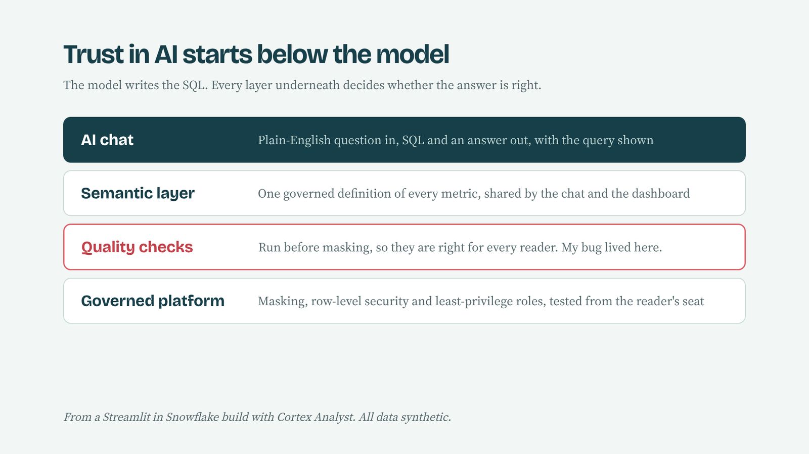

> **In brief:** My Snowflake app reported 6,000 bad records. The real number was 22. The SQL was correct and the security worked as designed, which is exactly why the error was easy to miss. As AI starts writing our queries, trust has to be built into the platform underneath the model.

## The number that looked fine

This week I built a Streamlit app inside Snowflake for a portfolio project: a virtual care company, all synthetic data, with governed tables, masking and an AI chat over the data. I opened the Data quality tab, and it told me 6,000 member records had malformed email addresses.

The right answer was 22.

Nothing errored. The query ran, the page loaded, and the number sat in a clean table next to a pass rate of 96.7%. If I hadn't built the data myself and known roughly what to expect, I might have believed it. That's the kind of mistake that worries me most: not a broken answer, but a confident one.

## Why it happened

The app runs as a least-privilege role that isn't allowed to see personal data. That's on purpose: Snowflake masks names, emails and phone numbers before the app ever receives them, so an email like jane.doe@example.com arrives as \*\*\*\*\*@example.com.

The catch is that masking applies to whoever is running the query, even when the query sits inside a view someone else built. My data quality check re-validated each email on the fly. Under the app's role, every email it checked was already masked, and a string of asterisks isn't a valid email. So all 6,000 failed.

It was wrong only for the people who weren't allowed to see the real data, which is most of them.

> The security worked exactly as designed. The check was what was wrong.

The fix was simple once I saw it: run the quality checks when the tables are built, by a role that sees the real values, and store the results. Readers then see the flags, not a fresh check against data they can't see.

## What this means for AI on your data

The same app has a chat tab. You ask a question in plain English, and Snowflake's Cortex Analyst writes the SQL and returns a table and a chart in seconds. It's genuinely impressive, and it writes SQL faster than I do.

But my bug had nothing to do with SQL. The SQL was correct. The answer was wrong because of what sat underneath it. An AI that writes perfect queries against a platform with a flaw like that will return confident wrong answers faster and to more people.

So the trust has to come from the platform, not the model.

In my build, that meant three things:

1. **One definition of every metric.** The AI queries a governed semantic view, not raw tables, so "average wait time" means the same thing in the chat as on the dashboard.
2. **Quality checks that run before security is applied.** Otherwise the checks themselves are wrong for most readers.
3. **The SQL shown with every answer.** Anyone can open it and see exactly what was asked of the data. A confident answer you can inspect is very different from one you have to take on faith.

## The job doesn't shrink, it moves

I read a post this week by Marc-Anthony Hart that said it well: as AI takes over writing queries, the analyst's role shifts from writing queries to checking them, and the technical skills matter more, "because you need them to tell a good answer from a confident one."

I'd push that one step further. Checking answers one at a time doesn't scale when an AI is answering hundreds of questions a day. The bigger job is designing the system so the answers are trustworthy before anyone asks: governed definitions, security that's tested from the reader's side, quality checks in the right place, and transparency built into every answer.

That's architecture work. It's also the part no model can do for you, because it depends on knowing the data, the business and the people who will rely on the answers.

## If your team is putting AI on top of its data

A few questions I'd ask before trusting the first answer:

- **Test from the reader's seat.** Run your checks and dashboards as the least-privileged role that will use them, not as an admin. My bug was invisible to anyone with full access.
- **Know your expected numbers.** Before you look at an answer, have a rough idea of what it should be. Surprise is a signal, not a finding.
- **Make the AI show its work.** If people can't see the query behind an answer, they can't challenge it.
- **Put the definitions in one place.** If the chat and the dashboard can disagree about a metric, eventually they will.

The 22 bad emails were never the interesting part. The interesting part was a correct-looking 6,000, and how easily a well-governed system can produce one.

You can see the full build, including the app, the SQL and the fix, in [Virtual Care Analytics: An AI-Ready Streamlit App in Snowflake](/2026/11/19/virtual-care-streamlit-app.html).
