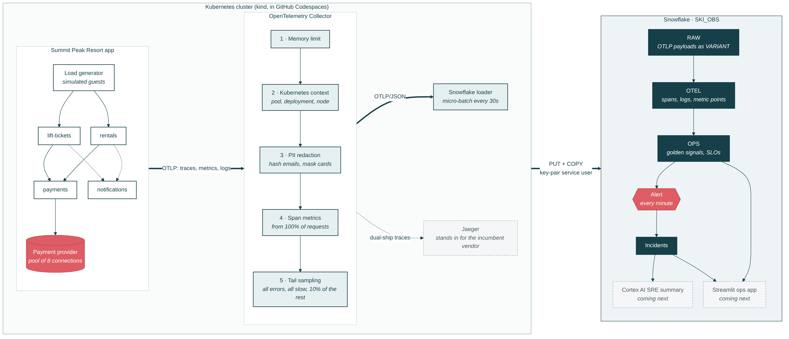
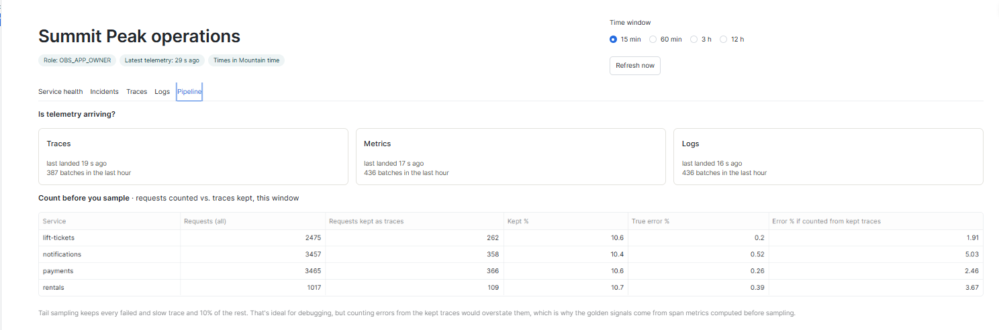
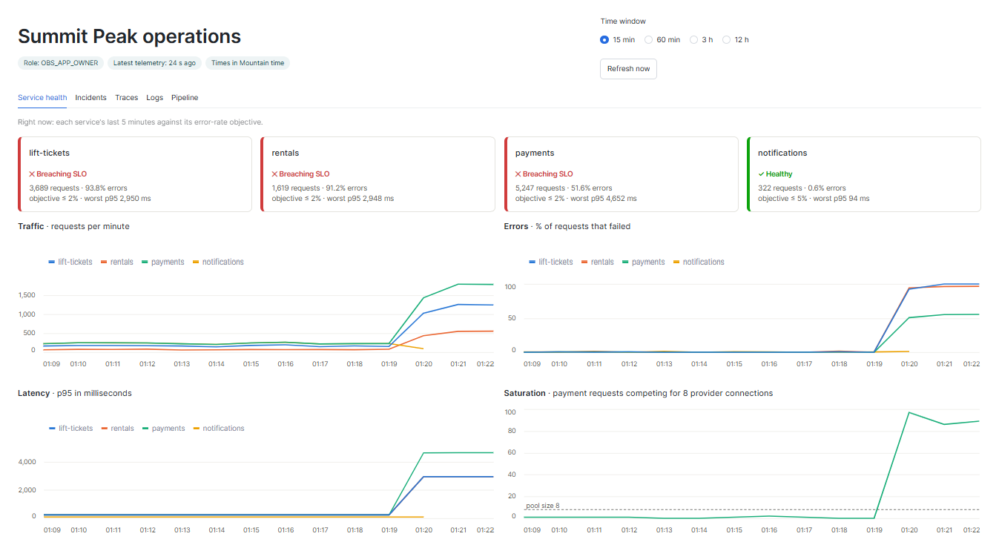
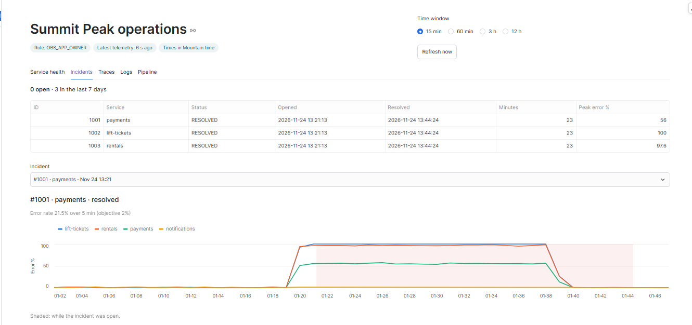
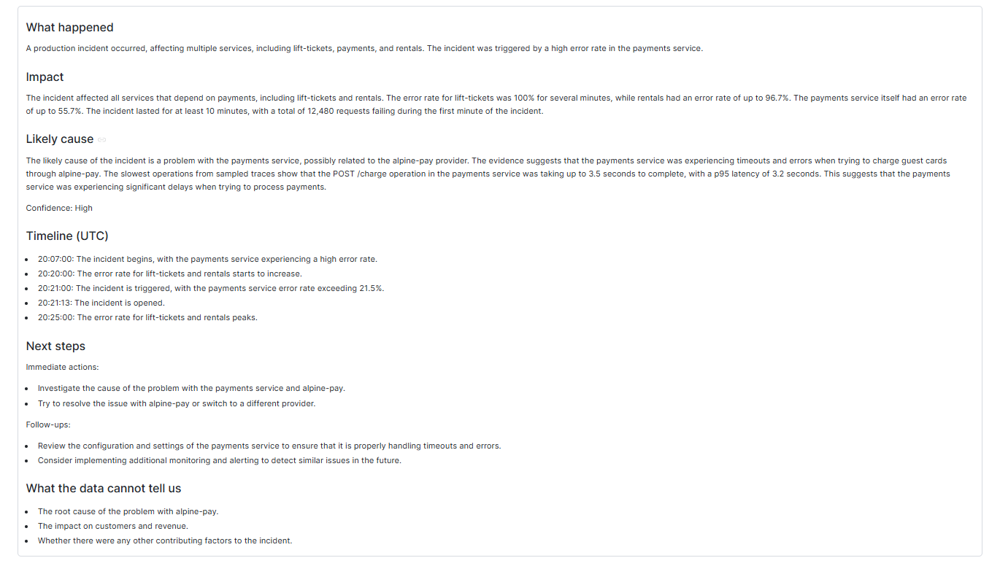
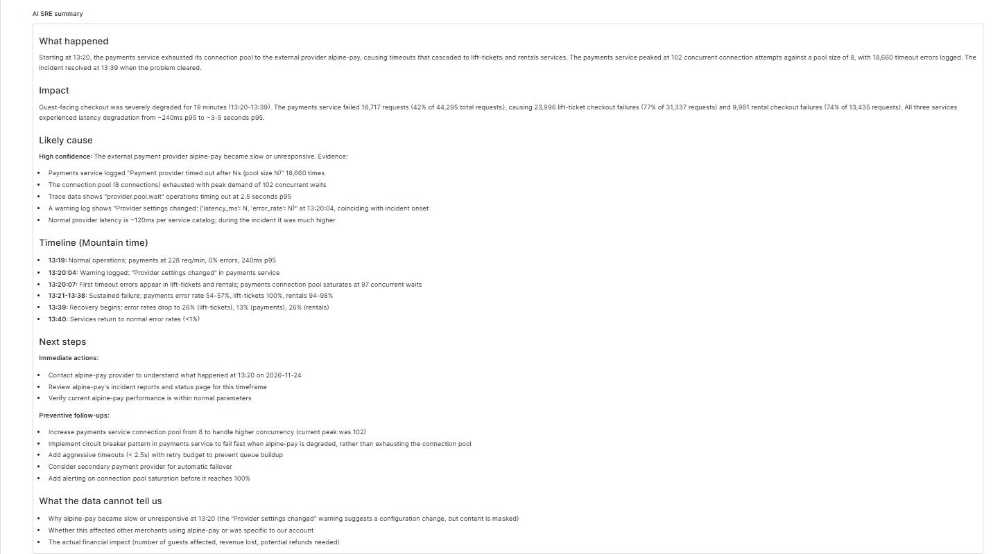

Fresh snow is the best day of the season for a ski resort, and the worst day for its payment system. For the first project in my weekly build series, I built an observability platform for a fictional ski area, Summit Peak Resort, then broke it on purpose to see whether it would catch the failure and explain it.

Everything here is synthetic. The app, the guests and their card numbers (standard test numbers) are all generated.

**Links:** [the postmortem](/2026/11/25/powder-day-postmortem.html), [code on GitHub](https://github.com/brandyemurray/observability-on-snowflake) (it runs in GitHub Codespaces with one command), [Collector configuration](https://github.com/brandyemurray/observability-on-snowflake/blob/main/collector/collector.yaml), [Snowflake scripts](https://github.com/brandyemurray/observability-on-snowflake/tree/main/snowflake), [ops app](https://github.com/brandyemurray/observability-on-snowflake/blob/main/streamlit/ops_app.py).

## Start with what has to be true

Before any code, I asked the questions I'd ask a real client:

- **When checkouts fail, do we know within minutes**, or when guests start complaining?
- **Can guest emails and card numbers stay out of every monitoring tool**, even when a developer logs them by mistake?
- **Are the error rates accurate** even though we only keep a fraction of the traces?
- **Can we move off the current vendor without changing app code**, and prove the new platform matches before we cut over?

Each answer became a design decision.

## The architecture

**The app.** Four Python services on Kubernetes: lift tickets, rentals, payments and confirmation emails. Payments charges cards through an outside provider over a pool of 8 connections, which is plenty on a normal day. A load generator plays the guests.

**The OpenTelemetry Collector** is the one place every trace, metric and log passes through, so that's where the important decisions live:

1. **PII is removed at the edge.** Guest emails are hashed (so analysts can still count unique guests) and card numbers keep only the last four digits, in span attributes and in log text. The app even logs card numbers on purpose, to prove the rule holds. The result: 0 emails and 0 card numbers across 6,217 log records in Snowflake.
2. **Count before you sample.** Tail sampling keeps every failed trace, every slow trace and 10% of the rest. That's ideal for debugging and terrible for counting: on a normal day, error rates calculated from the stored traces were nearly 10 times too high (1.91% instead of 0.2% for lift tickets). So request, error and latency metrics are computed from 100% of spans before sampling, and the golden signals use those.
3. **Dual-ship during migration.** Traces go to Snowflake and to Jaeger, which stands in for the incumbent vendor. Running both side by side is how you prove the new platform matches before you turn the old one off.

**Snowflake** stores each OTLP payload unchanged as VARIANT, so a new attribute never needs a schema change. Views flatten it into spans, logs and metric points; a golden signals view gives traffic, errors, p50/p95/p99 latency and saturation per service per minute. SLOs are stored as data, a Snowflake alert checks them every minute, and incidents open and resolve on their own. A masking policy is the second line of defense for log text, and a key-pair service user can load data but read nothing.

## The incident

With the lab running normally, I ran one command: traffic jumped to a powder-day 30 requests a second, and the payment provider slowed from about 120 ms to about 600 ms per charge.

- **Checkout collapsed.** Lift tickets failed 94% of requests and rentals 91%, against a 2% objective.
- **The cause was on the saturation chart.** Payment requests waiting for one of the 8 provider connections jumped from about 1 to about 100. Neither change alone would have done it: a quiet day absorbs a slow provider, and a fast provider absorbs a powder day.
- **Payments showed fewer errors than its callers** (52% vs. 94%). Callers give up after 2 seconds, but payments keeps waiting up to 2.5, so many charges finished after the guest had already been told it failed. That timeout mismatch is a real finding.
- **Notifications went quiet** without being broken: no completed purchases, no confirmation emails.

Snowflake opened incidents for lift tickets, rentals and payments about 2 minutes after the failures started. When the provider recovered, errors dropped to zero within a minute while traffic stayed at powder-day levels, which confirmed the diagnosis. The incidents resolved themselves after five healthy minutes.

## The AI SRE summary, and why the first one was wrong

Each incident has a button that asks Cortex AI to write the first summary. It runs with the caller's permissions, so the model only sees masked log text, and it's told to use only the evidence it's given.

The first version gathered the raw evidence (minute-by-minute golden signals, top error logs, the slowest operations) and passed it straight to the model. The result read confidently and missed the point: it never mentioned the connection pool, put the start time 12 minutes early, and invented a failure count.

I didn't switch to a cleverer prompt first. I improved the evidence:

- **Compute the facts in SQL.** Before and during comparisons for every service (traffic, error rate, p95, saturation), when each service first broke its objective, when it last had traffic, and total failures. The model reads facts instead of doing arithmetic on long arrays.
- **Give it the context an SRE would have:** a service catalog with each service's dependencies and capacity, and rules for reading the evidence, such as checking saturation against capacity and not blaming a service that went quiet because nothing reached it.

The second version named the mechanism (the pool of 8 exhausted, 102 requests waiting), found the "provider settings changed" log line at the exact moment the incident started, got the timeline right, and proposed specific fixes: a circuit breaker, a timeout budget and an alert on pool saturation.

It still treated the slow provider as the whole cause and missed that traffic had jumped eightfold at the same moment. That's the part I keep coming back to: the AI got to a good answer in seconds, but a person who knew the system still had to check its reasoning. Trust comes from the evidence underneath the model.

## What I'd do in production

- **Snowpipe Streaming instead of PUT and COPY.** The loader micro-batches every 30 seconds because it's simple to inspect. At real volume, streaming removes the need for a running warehouse.
- **A load-balancing Collector tier.** Tail sampling needs every span of a trace on the same Collector. One replica works in a lab; production routes spans by trace ID.
- **Agent plus gateway.** A Collector on every node for host metrics and container logs, forwarding to the gateway tier shown here.
- **Burn-rate alerts.** A fixed 2% threshold over five minutes is easy to explain; error-budget burn rates page less and catch slow leaks.
- **Fix the app, not just the alerting.** Callers should time out after payments does, and payments should shed load once its queue passes the pool size instead of making everyone wait.

## Built with

OpenTelemetry (Python SDK and Collector), Kubernetes (kind) in GitHub Codespaces, Jaeger, Snowflake (VARIANT, views, Python UDFs, masking policies, alerts, tasks, resource monitors), Cortex AI (AI_COMPLETE), and Streamlit in Snowflake.
